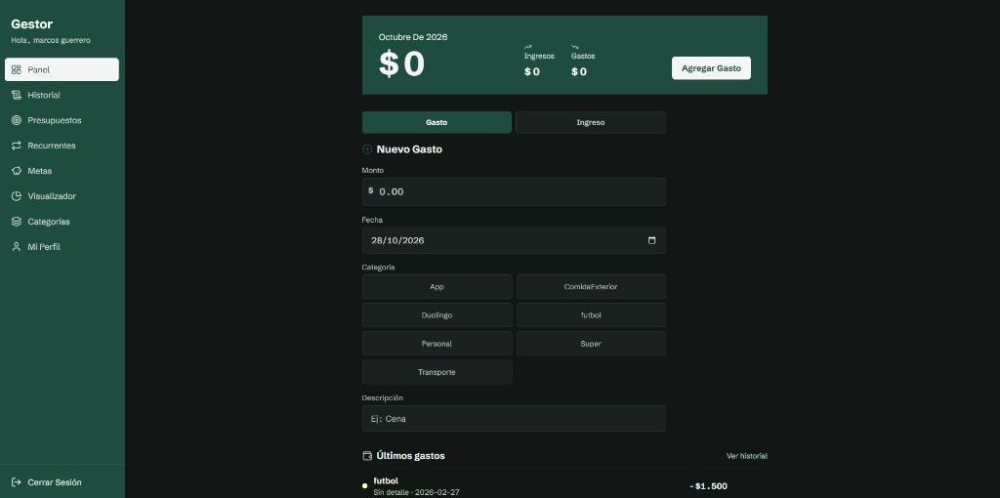
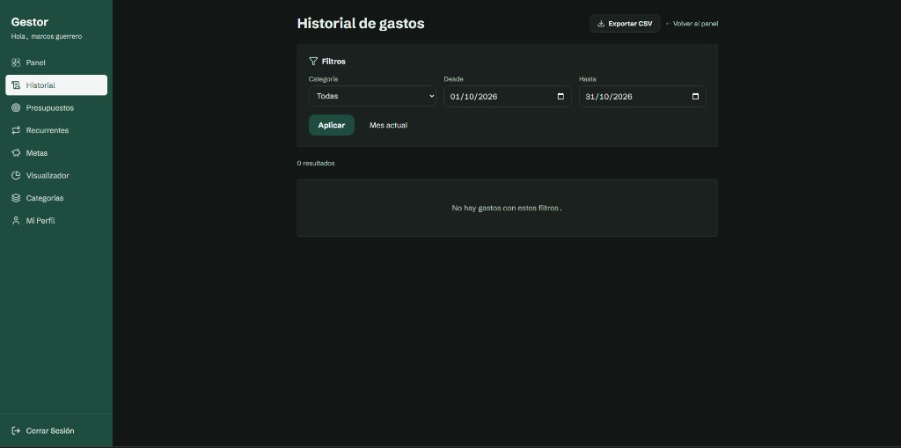

# Gestor de Gastos — frontend (PWA)

Aplicación web para registrar **gastos e ingresos**, categorías, presupuestos mensuales, historial con export CSV y gráficos. Backend: [Supabase](https://supabase.com) (Auth + Postgres con RLS).

## Capturas

| Panel (balance y nuevo gasto) | Historial (filtros y export CSV) |
| --- | --- |
|  |  |

## Requisitos

- Node.js 20+ (22 recomendado en CI)
- Proyecto Supabase configurado (ver guía en el repo completo: `../supabase/SETUP.md`)

## Variables de entorno

Copiá `.env.example` a `.env` en esta carpeta:

| Variable | Descripción |
|----------|-------------|
| `VITE_SUPABASE_URL` | URL del proyecto (Settings → API) |
| `VITE_SUPABASE_ANON_KEY` | Clave **anon / publishable** (nunca la service role en el frontend) |

```bash
cp .env.example .env
# editá los valores
```

## Desarrollo local

```bash
npm install
npm run dev
```

Abrí [http://localhost:5173](http://localhost:5173). En Supabase → Authentication → URL configuration, incluí `http://localhost:5173/**` en redirect URLs.

## Scripts

| Comando | Uso |
|---------|-----|
| `npm run dev` | Servidor de desarrollo Vite |
| `npm run build` | Build de producción en `dist/` |
| `npm run preview` | Previsualizar el build |
| `npm run lint` | ESLint |
| `npm run test` | Tests unitarios (Vitest) |
| `npm run test:watch` | Tests en modo watch |

## Despliegue (Render Static Site)

1. Conectá este repositorio en [Render](https://render.com).
2. **Static Site** (o Blueprint con [`render.yaml`](./render.yaml)):
   - **Build command:** `npm ci && npm run build`
   - **Publish directory:** `dist`
3. Definí en el servicio las env vars `VITE_SUPABASE_URL` y `VITE_SUPABASE_ANON_KEY` (se inyectan en el **build**).
4. Regla SPA: rewrite `/*` → `/index.html` (incluida en `render.yaml`).
5. En Supabase, agregá la URL de Render (`https://tu-app.onrender.com/**`) en Site URL y Redirect URLs.

La PWA se genera con `vite-plugin-pwa` (`registerType: autoUpdate`). Al publicar una versión nueva, la app muestra un aviso para recargar.

### Offline

- Sin red: lectura desde IndexedDB (panel reciente, categorías, totales del mes cacheados).
- Altas/edición de gastos, ingresos y categorías se encolan y sincronizan al reconectar.
- Presupuestos, metas, recurrentes y export CSV requieren conexión.

### Migración SQL (proyectos existentes)

Ejecutá en Supabase SQL Editor:

`../supabase/migrations/20261028180000_recurring_and_goals.sql`

### Tema y seguridad local

- Perfil → Tema (sistema / claro / oscuro).
- Perfil → Bloqueo al abrir (WebAuthn / biometría del dispositivo cuando el navegador lo permite).
- iOS: instrucciones de “Agregar a pantalla de inicio” en Perfil.

**Push:** no implementado; las alertas de presupuesto son toasts in-app en el Panel.

## Estructura del código

```
src/
├── components/   # Pantallas UI
├── services/     # Consultas Supabase
├── hooks/        # Datos compartidos (categorías)
├── context/      # Toasts
├── utils/        # Fechas, CSV, cálculos financieros (+ tests)
└── constants/
```

## CI

GitHub Actions (`.github/workflows/ci.yml`): `lint` → `test` → `build` en cada push/PR a `main`.

## Base de datos

El schema SQL y migraciones viven en la carpeta hermana `supabase/` del monorepo local (`bootstrap_fresh_project.sql`, `migrations/`). Si solo clonaste el repo del frontend, pedí o copiá esos archivos y seguí `supabase/SETUP.md`.
